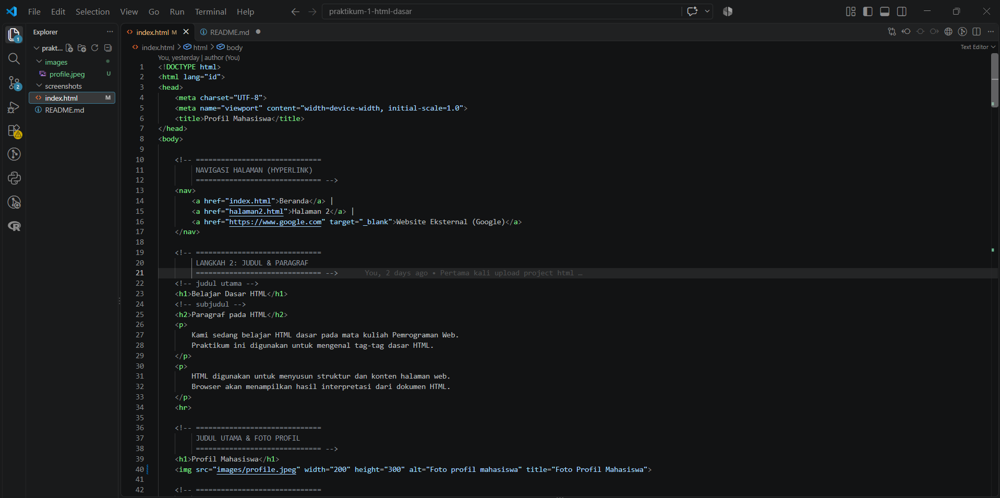
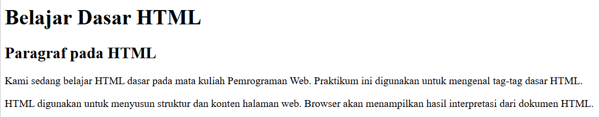
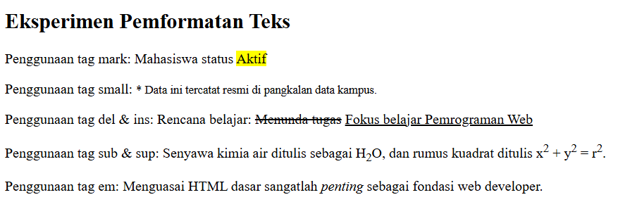
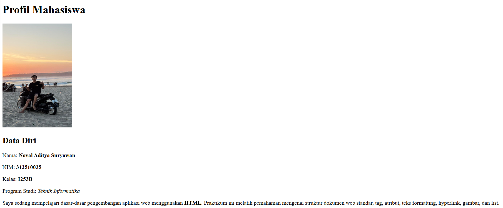
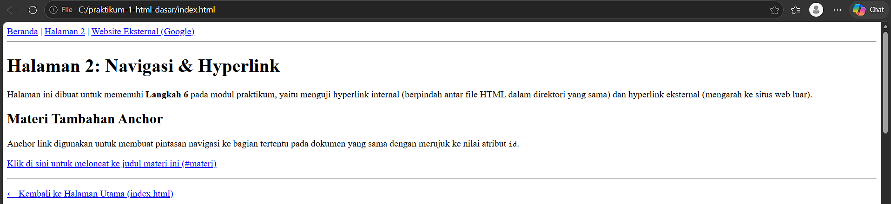
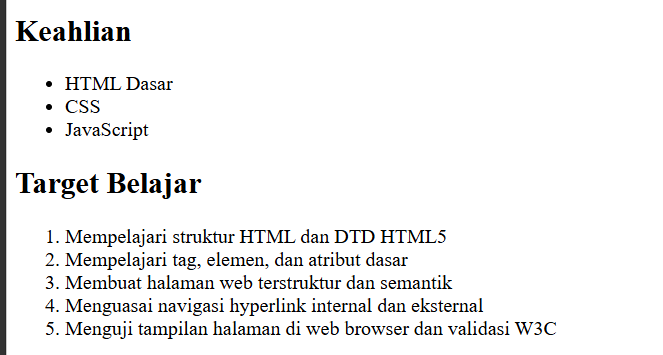
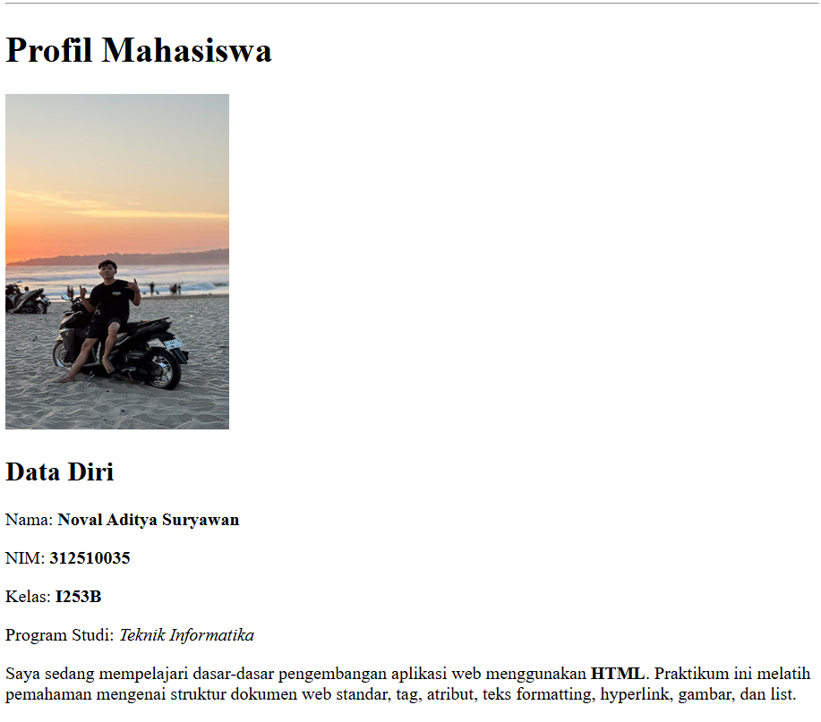

# Praktikum 1: HTML Dasar

Repository ini dibuat untuk memenuhi tugas **Praktikum 1 - HTML Dasar** pada mata kuliah Pemrograman Web.

Identitas Mahasiswa:

- **Nama:** Noval Aditya Suryawan
- **NIM:** 312510035
- **Kelas:** I253B
- **Program Studi:** Teknik Informatika
- **Dosen Pengampu:** Sufajar Butsianto, S.Kom, M.Kom
- **Kampus:** Universitas Pelita Bangsa

## Panduan Screenshot Tugas

Simpan semua file tangkapan layar (screenshot) di dalam folder `screenshots/` dengan format nama angka (`1.png` sampai `8.png`) sesuai tabel berikut:

| No File | Aplikasi / Lokasi | Yang Harus Di-Screenshot |
| :---: | :--- | :--- |
| **1.png** | VS Code (Editor) | Kode struktur dasar HTML5 pada `index.html` (`<!DOCTYPE html>`, `<html>`, `<head>`, `<body>`). |
| **2.png** | Browser | Tampilan heading `<h1>`, `<h2>`, dan teks paragraf `<p>` di browser. |
| **3.png** | Browser | Tampilan hasil pemformatan teks (`<b>`, `<i>`, `<mark>`, `<sub>`, `<sup>`, `<del>`, `<ins>`). |
| **4.png** | Browser | Tampilan gambar foto profil mahasiswa (`images/profil.jpg`) dengan lebar 200px. |
| **5.png** | Browser | Tampilan file `halaman2.html` yang menunjukkan navigasi link dan anchor link. |
| **6.png** | Browser | Tampilan Unordered List (`<ul>` keahlian) dan Ordered List (`<ol>` target belajar). |
| **7.png** | Browser | Tampilan utuh satu halaman Profil Mahasiswa (`index.html`) dari atas sampai bawah. |
| **8.png** | Browser<br>([validator.w3.org](https://validator.w3.org)) | Hasil validasi W3C yang menunjukkan halaman bebas error (hijau). |

## Struktur Folder
```
text
Lab1Web/
├── index.html
├── halaman2.html
├── images/
│   └── profil.jpg
├── screenshots/
│   ├── 1.png
│   ├── 2.png
│   ├── 3.png
│   ├── 4.png
│   ├── 5.png
│   ├── 6.png
│   ├── 7.png
│   └── 8.png
└── README.md
```
## Langkah Pengerjaan Selanjutnya
## 1. Sturktur Data HTML 
Membuat file index.html dengan kerangka dokumen HTML5: deklarasi <!DOCTYPE html>, tag <html>, <head> untuk judul tab browser, dan <body> untuk tempat konten diletakkan.

<!DOCTYPE html>
<html lang="id">
<head>
    <meta charset="UTF-8">
    <title>Praktikum HTML Dasar</title>
</head>
<body>
</body>
</html>



## 2. Menambahkan Heading dan Paragraf
Menambahkan judul utama dengan <h1>, subjudul dengan <h2>, serta teks paragraf menggunakan tag <p>.

<!-- Judul utama dan subjudul -->
<h1>Belajar Dasar HTML</h1>
<h2>Paragraf pada HTML</h2>

<!-- Paragraf -->
<p>
    Kami sedang belajar HTML dasar pada mata kuliah Pemrograman Web.
    Praktikum ini digunakan untuk mengenal tag-tag dasar HTML.
</p>
<p>
    HTML digunakan untuk menyusun struktur dan konten halaman web.
    Browser akan menampilkan hasil interpretasi dari dokumen HTML.
</p>



## 3. Pemformatan Teks
Mencoba berbagai tag pemformatan teks di HTML, seperti cetak tebal (<b>, <strong>), miring (<i>, <em>), tanda sorot (<mark>), teks kecil (<small>), teks coret (<del>), teks sisipan (<ins>), serta tulisan indeks bawah (<sub>) dan pangkat (<sup>).

<p>Belajar <b>HTML dasar</b> pada mata kuliah <i>Pemrograman Web</i>.</p>
<p>HTML adalah <strong>bahasa markup</strong> untuk membuat halaman web.</p>
<p>Status: <mark>Mahasiswa Aktif</mark> | Catatan: <small>Semester Gasal</small></p>
<p>Target: <del>Malas-malasan</del> <ins>Rajin Ngoding</ins></p>
<p>Contoh rumus: H<sub>2</sub>O dan rumus kuadrat x<sup>2</sup> + y<sup>2</sup> = r<sup>2</sup></p>



## 4 & 5. Menyisipkan dan Mengatur Ukuran Gambar
Menyimpan file foto di folder images/profil.jpg, kemudian menampilkannya menggunakan tag  dengan atribut src, alt, title, serta mengatur ukuran lebarnya melalui atribut width.
<h3>Foto Profil</h3>




## 6. Hyperlink dan Halaman Baru (halaman2.html)
Membuat file baru bernama halaman2.html untuk mempraktikkan navigasi:

Link Internal: Berpindah antar file (index.html dan halaman2.html).
Link Eksternal: Mengarahkan ke situs luar seperti Google (https://www.google.com).
Anchor Link: Melompat ke bagian tertentu di halaman yang sama menggunakan #id.
Potongan kode navigasi:
<nav>
    <a href="index.html">Dasar HTML / Profil Mahasiswa</a> |
    <a href="halaman2.html">Halaman 2</a> |
    <a href="https://www.google.com" target="_blank">Website Eksternal</a>
</nav>
<hr>

<!-- Contoh Anchor Link -->
<h2 id="materi">Materi Tambahan</h2>
<p><a href="#materi">Klik untuk loncat ke judul materi ini</a></p>



## 7. Menambahkan List (Daftar)
Mengelompokkan data menggunakan list:

<ul> (Unordered List): Daftar menggunakan bullet/poin tanpa nomor urut (contoh: daftar keahlian).
<ol> (Ordered List): Daftar berurutan dengan nomor 1, 2, 3 (contoh: target belajar).
<h2>Keahlian</h2>
<ul>
    <li>HTML Dasar</li>
    <li>CSS</li>
    <li>JavaScript</li>
</ul>

<h2>Target Belajar</h2>
<ol>
    <li>Mempelajari struktur HTML</li>
    <li>Mempelajari tag dan atribut</li>
    <li>Membuat halaman HTML</li>
    <li>Menguji halaman pada browser</li>
</ol>



## 8. Menambahkan Komentar
Menambahkan komentar HTML menggunakan format <!-- isi komentar --> sebagai penanda bagian kode agar dokumen rapi dan mudah dibaca saat diedit kembali.
<!-- Bagian Profil Mahasiswa -->
<h2>Profil Mahasiswa</h2>

<!-- Bagian Keahlian -->
<ul>
    <li>HTML</li>
    <li>CSS</li>
</ul>

## 9. Halaman Profil Mahasiswa (Gabungan Semua Elemen)
Menggabungkan semua elemen yang sudah dipelajari menjadi satu halaman index.html yang utuh.

Isi lengkap index.html:

<!DOCTYPE html>
<html lang="id">
<head>
    <meta charset="UTF-8">
    <meta name="viewport" content="width=device-width, initial-scale=1.0">
    <title>Profil Mahasiswa</title>
</head>
<body>
```
    <!-- Navigasi Halaman -->
    <nav>
        <a href="index.html">Beranda</a> |
        <a href="halaman2.html">Halaman 2</a> |
        <a href="https://www.google.com" target="_blank">Website Eksternal (Google)</a>
    </nav>
    <hr>
```
    <!-- Langkah 2: Judul & Paragraf Dasar -->
    <h1>Belajar Dasar HTML</h1>
    <h2>Paragraf pada HTML</h2>
    <p>
        Kami sedang belajar HTML dasar pada mata kuliah Pemrograman Web.
        Praktikum ini digunakan untuk mengenal tag-tag dasar HTML.
    </p>
    <p>
        HTML digunakan untuk menyusun struktur dan konten halaman web.
        Browser akan menampilkan hasil interpretasi dari dokumen HTML.
    </p>
    <hr>
`
    <!-- Judul dan Foto -->
    <h1>Profil Mahasiswa</h1>
    
`
    <!-- Data Diri -->
    <h2>Data Diri</h2>
    <p>Nama: <b>Noval Aditya Suryawan</b></p>
    <p>NIM: <b>312510035</b></p>
    <p>Kelas: <b>I253B</b></p>
    <p>Program Studi: <i>Teknik Informatika</i></p>
    <p>
        Saya sedang mempelajari dasar-dasar pengembangan aplikasi web menggunakan <strong>HTML</strong>.
        Praktikum ini melatih pemahaman mengenai struktur dokumen web standar, tag, atribut, teks formatting, hyperlink, gambar, dan list.
    </p>
`
    <!-- Pemformatan Teks Tambahan -->
    <h2>Eksperimen Pemformatan Teks</h2>
    <p>Status: <mark>Aktif</mark></p>
    <p><small>* Terdaftar resmi di pangkalan data kampus.</small></p>
    <p>Rencana: <del>Menunda tugas</del> <ins>Fokus belajar Pemrograman Web</ins></p>
    <p>Contoh penulisan ilmiah: H<sub>2</sub>O dan x<sup>2</sup> + y<sup>2</sup> = r<sup>2</sup></p>
    <p>Belajar HTML dasar sangat <em>penting</em> sebagai fondasi web developer.</p>
`
    <!-- Keahlian & Target -->
    <h2>Keahlian</h2>
    <ul>
        <li>HTML Dasar</li>
        <li>CSS</li>
        <li>JavaScript</li>
    </ul>
`
    <h2>Target Belajar</h2>
    <ol>
        <li>Mempelajari struktur HTML dan DTD HTML5</li>
        <li>Mempelajari tag, elemen, dan atribut dasar</li>
        <li>Membuat halaman web terstruktur dan semantik</li>
        <li>Menguasai navigasi hyperlink internal dan eksternal</li>
        <li>Menguji tampilan halaman di web browser dan validasi W3C</li>
    </ol>
`
    <hr>
    <p><small>&copy; 2026 Praktikum Pemrograman Web - Lab1Web</small></p>

</body>
</html>


```